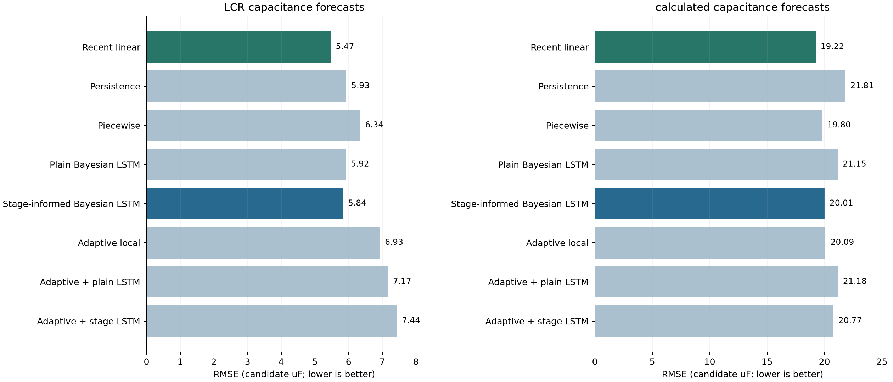

# Capacitor RUL: Bayesian forecasting with honest baselines

**Can a Bayesian LSTM predict capacitor degradation better than a recent straight-line trend?** This project tests that question using LCR readings and independently calculated discharge capacitance, then evaluates the remaining cycles to a 20% capacitance-loss limit.

Python · PyTorch · time-series forecasting · measurement diagnostics · uncertainty · reliability engineering



**Main finding:** stage information modestly improved the neural forecasts, but recent linear remained the best overall capacitance forecaster. The tested RC auxiliary loss and direct dual-sensor compromise did not improve LCR accuracy. RUL errors remained substantial. These are results from one previously inspected device, not a validated lifetime predictor for new capacitors.

## Start here

| Your goal | Read / run |
|---|---|
| Understand the engineering work quickly | [Project case study](docs/case-study.md) |
| Inspect the actual results and limitations | [Results](docs/results.md) |
| Try the code without research data | Run the synthetic demo below |
| Forecast your own capacitor measurements | [Bring your own data](docs/data-format.md) |
| Understand the Bayesian and physics-informed losses | [Methods and formulas](docs/methods.md) |

## What this repository provides

- A small installable package and command-line workflow, independent of the original experiment folders.
- Separate LCR and calculated-capacitance forecasts; their measurements are not silently calibrated to agree.
- Persistence, recent-linear and piecewise baselines; MC-dropout LSTMs with and without past-only stage context.
- Experimental RC-equivalent and fixed-weight dual-capacitance training objectives.
- Chronological model selection, availability-aware windows, fixed sensor-specific EOL references, and explicitly censored RUL paths.
- Forecast errors, R², uncertainty scores, checkpoint metadata, split audits, plots and SHA-256 run manifests.
- Small synthetic example data and tests. **The private raw recordings and model weights are not distributed.**

## Quick start

Python 3.11 or newer is required. Run these commands in a terminal:

```bash
git clone https://github.com/Codeharshw/capacitor-rul.git
cd capacitor-rul
python -m venv .venv
```

Activate the environment:

```powershell
# Windows PowerShell
.venv\Scripts\Activate.ps1
```

```bash
# macOS / Linux
source .venv/bin/activate
```

Then install and run:

```bash
python -m pip install -e .
python -m unittest discover -s tests -v
python -m capacitor_rul validate examples/synthetic_measurements.csv
python -m capacitor_rul run examples/synthetic_measurements.csv --config examples/quickstart.json --out outputs/quickstart
```

The example trains small models for a few epochs on CPU. **Its scores are demonstration results, not the research scores below.** Use a new `--out` folder for each run; existing results are never overwritten. To generate another copy of the synthetic example:

```bash
python -m capacitor_rul demo --out outputs/new_example
```

## Use your own data

Prepare one CSV for one physical capacitor, with measurements in microfarads:

```csv
sensor,event,available_event,capacitance_uf
LCR,1000,1100,594.2
calculated,1000,1000,941.7
LCR,1500,1600,593.8
```

`event` is the cumulative observed-cycle coordinate. `available_event` says when a measurement actually became available. It prevents a delayed LCR reading or completed-bin statistic from being used too early. Either sensor can be supplied on its own. Missing measurements are omitted, never interpolated from the future.

Set your own immutable initial references, forecast cutoffs and horizons in a config:

```bash
python -m capacitor_rul validate data/private/my_capacitor.csv
python -m capacitor_rul run data/private/my_capacitor.csv --config examples/full_config.json --out outputs/my_run
```

Edit that config before using it. Its example reference values are not universal capacitor specifications. See [data preparation and config rules](docs/data-format.md), especially if you start with raw voltage/current recordings.

## Research results at a glance

The later independent-sensor experiment used matched test cases across five planned blocks and four horizons. Errors are on the recorded candidate-uF scale.

| Method | LCR RMSE | Calculated-capacitance RMSE |
|---|---:|---:|
| Bayesian LSTM without stage context | 5.917 | 21.148 |
| Bayesian LSTM with stage context | 5.837 | 20.007 |
| **Recent linear** | **5.472** | **19.225** |

An earlier, separate 10,000-event experiment compared the original standard LSTM against the RC auxiliary-loss model: **LCR RMSE 7.730 vs 11.205**. Architecture, targets and scoring differ between these experiments; the two sets of numbers must not be ranked as one leaderboard.

Pooled R² can look good because capacitance declines across the record, while within-block prediction remains weak. [The results page includes both and the RUL errors](docs/results.md). Adding a CNN is a proposed next experiment, **not a completed result**.

## What a run writes

| File | Purpose |
|---|---|
| `summary.csv` | Equal-fold RMSE / MAE and MSE skill against recent linear |
| `fold_metrics.csv` | Per-block RMSE, MAE, bias, R² and neural interval scores |
| `predictions.csv` | Actual target, predicted value, target time and input/label availability |
| `rul.csv` | Pre-limit / already-below-limit status, medians, bounds and censored flags |
| `split_audit.csv` | Evidence that training labels preceded validation/test origins |
| `epoch_selection.csv` | Past-validation epoch choices, including the zero-epoch baseline fallback |
| `checkpoints/` | PyTorch state dictionaries and training-only scaling metadata |
| `*_comparison.png` | Matched forecast error and pre-limit RUL diagnostics |
| `config.json`, `provenance.json`, `manifest.json` | Reproduction settings, versions and fingerprints |

RUL paths continue a sampled degradation rate. They cannot establish when an unknown future stage change will occur. A censored estimate means the limit was not predicted within the configured horizon; it is not a zero or an exact lifetime. Baselines provide point estimates, not calibrated uncertainty bands.

## Reproducibility boundary

The portable package preserves the later stage-model numerical core and provides a configurable workflow for new data. It is a new, documented runner; it does not claim bit-for-bit reproduction of all historical experiments. The original raw recordings are not included, so historical numbers cannot be regenerated from the synthetic example. Selected aggregate evidence and its source hashes are provided in [research/results](research/results/).

The runner uses a fixed 10,000-event input history, 500-event bins/issue steps and a maximum 1,500-event stale-input tolerance. These assumptions must suit your test. [Methods](docs/methods.md) explains the architecture, experimental losses and all important differences from the original runs.

## Author and reuse

Built by [Harshvardhan Wagare](https://github.com/Codeharshw). Code and selected project figures are released under the [MIT License](LICENSE). See [CONTRIBUTING.md](CONTRIBUTING.md) for extensions and [CITATION.cff](CITATION.cff) for citation metadata.
