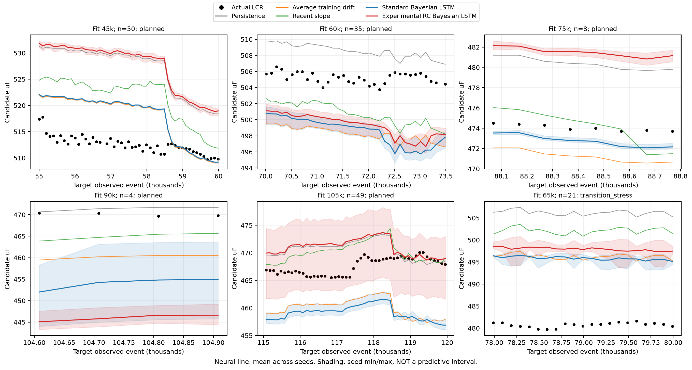
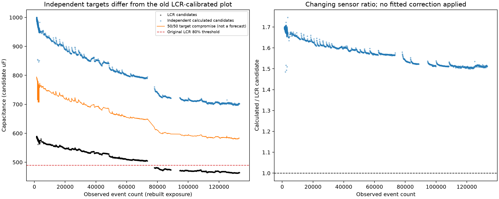
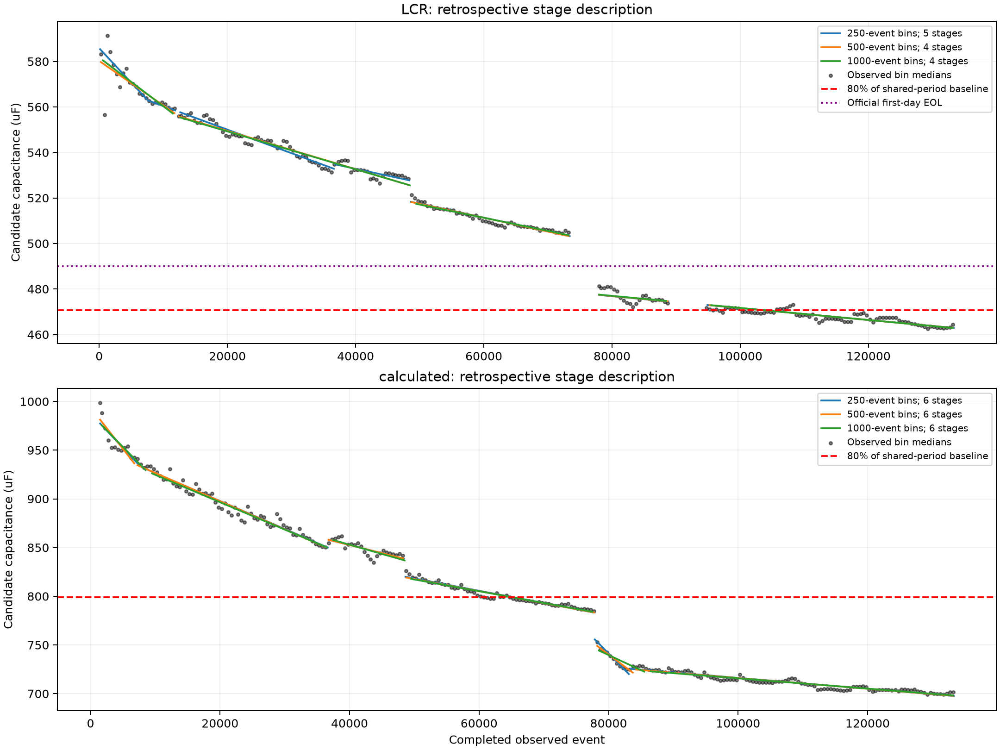
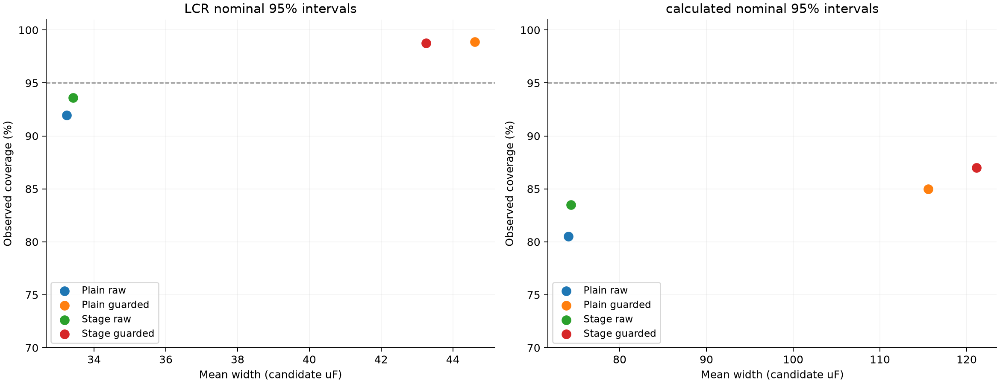
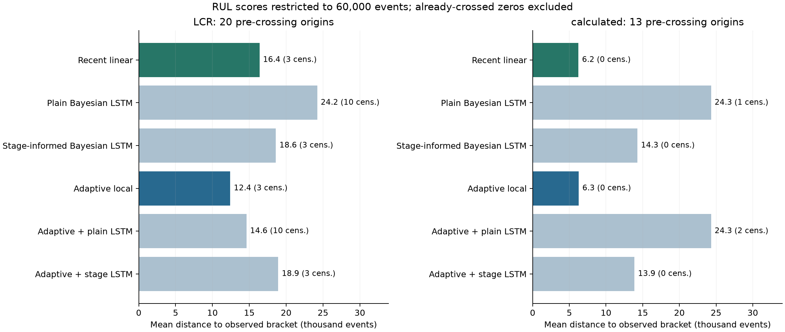

# Research results

These are aggregate results from the completed research record, not the synthetic demo. All capacitance figures retain their recorded **candidate-uF** interpretation. Circuit/unit validation and reference screening remain limitations. One capacitor and repeated forecast origins do not constitute independent-device validation.

## Original standard versus RC-loss experiment

Both models used two 32-unit layers and a 10k-event direct horizon. Five planned folds were evaluated on 146 distinct LCR targets; three seed MSEs were averaged, not predictions. A separate transition stress case is retained in the CSV.

| Method | Case-weighted RMSE | Equal-fold RMSE | MAE | 95% coverage | Full band width | Interval score |
|---|---:|---:|---:|---:|---:|---:|
| Standard Bayesian LSTM | 7.730 | 9.763 | 6.819 | 70.8% | 19.150 | 44.367 |
| Experimental RC Bayesian LSTM | 11.205 | 13.864 | 9.747 | 61.4% | 21.166 | 126.322 |

The standard model was better against LCR. The effective RC candidates disagreed with LCR (held-out median ratio about 1.565); enforcing the observation relation did not establish improved physical accuracy.

In this trajectory plot, shading is the **seed minimum/maximum**, not a predictive interval. Do not use its shading as evidence of 95% coverage.

## Separate dual-capacitance experiment

The residual model used fixed 50/50 calculated and LCR supervision. Standard residual LCR RMSE was 7.327; dual-loss LCR RMSE was 160.067. Compromise-target RMSE improved from 132.542 to 26.148, while mean full uncertainty width rose from 28.529 to 748.327 candidate uF. The compromise target is arithmetic, not independent physical truth. The experiment used different centering/log-variance settings and must not be merged into the original RC leaderboard.

## Later independent-sensor forecasts

Each sensor predicted its own future 500-event bin medians. Five planned cutoffs and four horizons used equal fold weight, then equal available horizon weight within each fold. The 65k transition stress case and adequate-support sensitivity are separate in the result CSV. Some LCR blocks are sparse; they remain in the primary scores.

| Method | LCR RMSE | LCR MAE | LCR pooled R² | LCR within-block R² | Calculated RMSE | Calculated MAE | Calculated pooled R² | Calculated within-block R² |
|---|---:|---:|---:|---:|---:|---:|---:|---:|
| Plain Bayesian LSTM | 5.917 | 4.270 | 0.918 | -2.482 | 21.148 | 13.325 | 0.783 | -2.968 |
| Stage-informed Bayesian LSTM | 5.837 | 4.183 | 0.920 | -2.388 | 20.007 | 12.518 | 0.806 | -2.552 |
| Recent linear | 5.472 | 3.988 | 0.930 | -1.977 | 19.225 | 12.021 | 0.821 | -2.279 |

Pooled R² uses the weighted mean across blocks. The within-block diagnostic divides the same squared errors by variation around each block's own mean; it is not the average of fold R². Overall capacitance decline can make pooled R² attractive while within-stage changes remain poorly predicted. These are not percentage accuracies.

On 118 matched issue opportunities, stage-LSTM normalized RMSE was 0.992% of LCR's overlap reference versus 1.951% of calculated capacitance's reference. This shows relative predictability against each own measurement, not which sensor is physically correct.

Retrospective stage fits describe the record. Forecast models obtain their stage context only from past observations; they are not given future breakpoints.

## Uncertainty

For the later stage model, raw nominal-95% coverage was 93.61% for LCR and 83.50% for calculated capacitance. Earlier-error guarded scaling raised coverage to 98.75% and 87.00%, while full widths increased from 33.410 to 43.251 and from 74.396 to 121.124 candidate uF respectively. Higher coverage came at the cost of width and did not change the means. Calculated interval scores did not improve with stage context on every comparison.

Raw means the model's original interval. Guarded means widened using earlier available errors. Neither has a formal coverage guarantee. The portable runner currently outputs raw moment intervals only; it does not claim to reproduce the historical guarded-calibration experiment.

## RUL

EOL is first passage below 80% of the fixed reference. Original first-day LCR C0 was 612.547 candidate uF (threshold 490.0376). The independent calculated reference was provisional at 998.529985 (threshold 798.823988), affected by the earlier 1000-uF screen. A separate shared-overlap LCR reference is a sensitivity definition, not a replacement for the official reference.

Primary planned pre-crossing results use 20 LCR origins and 13 calculated origins. They include censored medians at the 60k-event reporting boundary for the restricted score; already-crossed zeros are excluded. The table reports mean distance of a RUL median to the observed crossing **bracket**, not exact-time MAE.

| Method | LCR bracket distance (events) | Calculated bracket distance (events) |
|---|---:|---:|
| Plain Bayesian LSTM | 24,214 | 24,321 |
| Stage-informed Bayesian LSTM | 18,611 | 14,284 |
| Recent linear | 16,384 | 6,245 |
| Adaptive local | 12,422 | 6,290 |

These sensor columns use different thresholds and forecast origins, so their raw RUL errors cannot establish a better physical sensor. The latest record was already below both chosen limits: current conditional RUL was zero. Advance errors remained substantial. A 60k-censored interval intersecting the observed bracket is not precise lifetime prediction.

## Reproduction and evidence

The CSVs in `research/results/` retain the recorded aggregate scores, including sensitivity sets. `provenance.json` records the source-artifact hashes. No local paths, private raw recordings, per-cycle research data or trained weights are published. Without the original data, historical scores cannot be independently regenerated; the synthetic example tests operation only. The portable runner has its own declared architecture/objective and split differences documented in [methods](methods.md).

CNN/LSTM comparison, multi-device validation and a validated joint measurement model are future work. No improvement is claimed for them.
